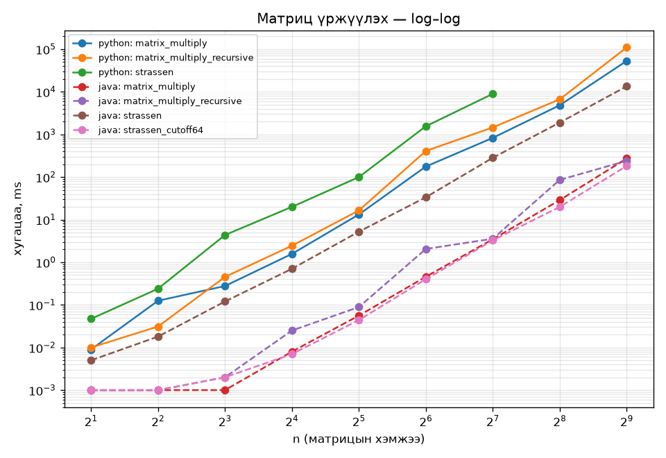

# Лаб №3 — Хэсэгчлэх

- Оюутны ID: **B190910014**
- Сонгосон хэл: **Python, Java**
- Хэмжилтийн орчин (`env_info.sh`, WSL2 Ubuntu 22.04):

```text
Linux DESKTOP-RA4LUQ2 6.6.87.2-microsoft-standard-WSL2 x86_64 GNU/Linux
Model name:     13th Gen Intel(R) Core(TM) i5-1334U
CPU(s): 12      Thread(s) per core: 2      Core(s) per socket: 6
L1d cache: 288 KiB (6 instances)   L2 cache: 7.5 MiB (6 instances)   L3 cache: 12 MiB
Mem: 7.6Gi
Python 3.10.12
openjdk version "17.0.20.1" 2026-08-18
```

| Хэл | Шалгалт | Үр дүн |
| --- | ------- | ------ |
| Python | `cd python && .venv/bin/pytest -v` | 76 passed, 4 skipped (n ≥ 128 Штрассены тоог зөвхөн томьёогоор шалгана) |
| Java | `cd java && mvn test` | Tests run: 18, Failures: 0 |

---

## 1. Ерөнхий арга

T(n) = aT(n/b) + f(n) тэгшитгэлд f(n) чиглүүлэгч функцийг n^(log_b a) урсгал функцтэй
харьцуулна (лекцийн Теорем 5.1–5.2). Хариу: `test_data/master_theorem_my.tsv`.

| id | Тэгшитгэл | n^(log_b a) | f(n) | Тохиолдол | Шийд |
| -- | --------- | ----------- | ---- | :-------: | ---- |
| R1 | 2T(n/2) + Θ(n) | n | n | 2 (k = 0) | Θ(n lg n) |
| R2 | T(n/2) + Θ(1) | 1 | 1 | 2 (k = 0) | Θ(lg n) |
| R3 | 8T(n/2) + Θ(1) | n³ | 1 | 1 (ϵ = 3) | Θ(n³) |
| R4 | 3T(n/4) + Θ(n²) | n^0.793 | n² | 3 | Θ(n²) |
| R5 | 4T(n/2) + Θ(n²) | n² | n² | 2 (k = 0) | Θ(n² lg n) |
| R6 | 2T(n/2) + Θ(n/lg n) | n | n/lg n | 0 | — |
| R7 | 7T(n/2) + Θ(n²) | n^lg7 ≈ n^2.807 | n² | 1 (ϵ ≈ 0.8) | Θ(n^lg7) |
| R8 | 2T(n/2) + Θ(n lg n) | n | n lg n | 2 (k = 1) | Θ(n lg² n) |

### (a) 2-р лабтай тулгах
- **R1** нь нэгтгэн эрэмбэлэлт. 2-р лабт давталтын модоор n = 2ᵏ үед бичилтийн тоо яг n·k = n lg n
  гэж гаргасан нь Θ(n lg n)-тэй таарна.
- **R2** нь хоёртын хайлт. 2-р лабт мод нь гинж бөгөөд дуудалтын тоо ⌊lg n⌋ + 2 гэж гаргасан нь
  Θ(lg n)-тэй таарна.

### (b) R4, R6, R8-ын бодолт
- **R4.** a = 3, b = 4 тул n^(log₄3) ≈ n^0.793. f(n) = n² = Ω(n^(0.793+ϵ)), ϵ = 1 (0 < ϵ ≤ 1.2 дурын).
  Тогтмол нөхцөл: a·f(n/b) = 3·(n/4)² = (3/16)·n² ≤ c·n², **c = 3/16 < 1** ✓. 3-р тохиолдол:
  T(n) = Θ(n²).
- **R6.** Доор (c)-д.
- **R8.** a = b = 2 тул n^(log₂2) = n. f(n) = n lg n = Θ(n¹ · lg¹ n) тул **k = 1 ≥ 0**. 2-р
  тохиолдол: T(n) = Θ(n lg^(k+1) n) = Θ(n lg² n).

### (c) R6-д ерөнхий арга яагаад үйлчлэхгүй вэ
Урсгал функц n, чиглүүлэгч n/lg n. Чиглүүлэгч нь урсгалаас бага боловч зөвхөн lg n дахин бага
бөгөөд дурын ϵ > 0-ийн хувьд lg n = o(n^ϵ) тул n/lg n ≠ O(n^(1−ϵ)). Иймд 1-р тохиолдол
биелэхгүй. n/lg n = Θ(n · lg^k n) байхын тулд k = −1 болох ёстой, гэтэл 2-р тохиолдол k ≥ 0-ийг
шаарддаг. 3-р тохиолдолд f нь урсгалаас их байх ёстой. Тиймээс f(n) нь 1 ба 2-р тохиолдлын
хоорондох «зааг» дээр унаж байна (лекцийн 200–201-р хуудас).

---

## 2. Матриц үржүүлэх — давталттай арга

`python/src/matrix_multiply.py`, `java/.../MatrixMultiply.java`. Лекцийн Matrix-Multiply-ийг
мөр бүрээр нь хөрвүүлж, үр дүн C болон скаляр үржүүлэлтийн тоог буцаадаг.

- **(a)** `matmul_01.tsv`-ийн 8 мөр хоёр хэл дээр давсан.
- **(b)** Хийсвэр кодын 4-р мөр `c_ij = c_ij + a_ik · b_kj` нь C-д **нэмдэг**. Тиймээс функц бүрт C-г
  шинээр тэглэдэг (Θ(n²)). Тэглээгүй C-г дахин ашиглавал хоёр дахь дуудалтад өмнөх үржвэр дээр
  нэмэгдэж буруу гарна. Үүнийг `test_second_call_gives_same_result` / `secondCallGivesSameResult`
  шалгалтаар барина.
- **(c)** A, B ижил n×n биш (2×2 ба 3×3, дөрвөлжин биш, мөр дутуу) үед Python `ValueError`,
  Java `IllegalArgumentException` шиднэ.
- **(d)** Гурван давталт тус бүр n удаа эргэдэг тул үржүүлэлт яг n³. Бүх мөрөнд хоёр хэл дээр
  шалгав, хариу ба тоо нь хоёр хэлэнд ижил.

---

## 3. Матриц үржүүлэх — дахин дуудах арга

`python/src/matrix_multiply_recursive.py`, `java/.../MatrixMultiplyRecursive.java`.

Дэд матрицыг хуулахгүй, зөвхөн зүүн дээд булангийн товъёгоор дамжуулна. Дуудалт бүр
`C[i.., j..] += A[i.., k..] · B[k.., j..]` гэсэн утгатай. C-ийн мөр нь A-ийн мөртэй, C-ийн багана нь
B-ийн баганатай, A-ийн багана нь B-ийн мөртэй давхцдаг тул (i, j, k) гурван товъёг хангалттай.
Лекцийн 5–12-р мөрийн 8 дуудалт нь (i, j, k)-д h = n/2-ыг нэмж хасах хослолууд. Суурь
нөхцөл n = 1.

- **(a)** `matmul_01.tsv`-ийн бүх мөрөнд хариу болон үржүүлэлтийн тоо 2-р даалгавартай яг ижил.
  Санамсаргүй 16×16, 32×32 матрицад ч таарсан.
- **(b)** Дуудалт бүр 8 дэд дуудалт хийж, өөрөө зөвхөн товъёг тооцоолно (Θ(1)):
  **T(n) = 8T(n/2) + Θ(1)**. Энэ нь 1-р даалгаврын **R3**: n^(log₂8) = n³ ≫ f(n) = 1 = O(n^(3−ϵ)),
  ϵ = 3. **1-р тохиолдол**, T(n) = Θ(n³).
- **(c)** Дэд матрицыг хуулбарладаг бол нэгтгэх алхам Θ(n²) болж **T(n) = 8T(n/2) + Θ(n²)** болно.
  n³ ба n²-ыг харьцуулахад n² = O(n^(3−ϵ)), ϵ = 1 хэвээр тул **1-р тохиолдол**, T(n) = Θ(n³).
  Хязгаарын шийд **өөрчлөгдөхгүй**, зөвхөн тогтмол үржүүлэгч өснө.

---

## 4. Штрассены алгоритм

`python/src/strassen.py`, `java/.../Strassen.java`. Лекцийн 4 алхам: (1) хуваах, (2) S₁…S₁₀,
(3) P₁…P₇-г дахин дуудалтаар, (4) C₁₁ = P₅ + P₄ − P₂ + P₆, C₁₂ = P₁ + P₂, C₂₁ = P₃ + P₄,
C₂₂ = P₅ + P₁ − P₃ − P₇. Суурь нөхцөл n = 1.

- **(a)** `matmul_01.tsv`-ийн бүх мөр 2, 3-р даалгавартай ижил. Санамсаргүй 16, 32, 64 хэмжээтэйд
  ч таарсан.
- **(b)** `strassen_counts_01.tsv`: алгоритмыг бодитоор ажиллуулж үржүүлэлтийг тоолоход Python-д
  n ≤ 64 (шалгалт) болон n ≤ 128 (хэмжилт), Java-д n ≤ 512 (хэмжилт) хүртэл яг **7^lg n** гарсан
  (n = 512: 40 353 607 = 7⁹). n = 1024-ийг томьёогоор шалгав.
- **(c)** n = 1024 үед энгийн арга 2³⁰ = 1 073 741 824, Штрассен 7¹⁰ = 282 475 249 үржүүлэлт
  хийнэ. **Харьцаа 3.80.** Ерөнхийдөө n³ / n^lg7 = **n^(3 − lg7) = n^0.193** тул n хоёр дахин өсөхөд
  харьцаа ердөө 8/7 ≈ 1.14 дахин өснө (n = 2: 1.14, n = 1024: 3.80). Давуу тал нь n-ээр маш удаан,
  гэхдээ хязгааргүй өснө.
- **(d)** Нэг түвшинд S₁…S₁₀ үүсгэхэд 10, C₁₁…C₂₂-ыг гаргахад 3 + 1 + 1 + 3 = 8, нийт **18** удаа
  n/2 × n/2 хэмжээтэй нэмэх/хасах үйлдэл хийнэ. Тус бүр (n/2)² гишүүнтэй тул
  18 · n²/4 = 4.5n² = **Θ(n²)**. Тиймээс чиглүүлэгч функц Θ(n²) бөгөөд
  T(n) = 7T(n/2) + Θ(n²) = **R7** = Θ(n^lg7).

---

## 5. Гүйцэтгэлийн хэмжилт ба огтлолцлын цэг

### (a), (b) Хэмжилт
`python3 ../tools/gen_lab03.py B190910014`-ээр n = 2, 4, …, 512 хувийн өгөгдөл үүсгэв. Хэмжилтийн
программ: `python/bench.py`, `java/.../Bench.java` → `out/results_<lang>.tsv` (n, algorithm,
time_ms, mults). n ≤ 128 үед 3 удаагийн медиан, түүнээс их үед 1 удаа. Java-д хэмжихийн өмнө JIT
халаасан. Гурван алгоритмын хариу n бүрд хоорондоо тэнцүү гэдгийг программ өөрөө шалгадаг.

**60 секундын хязгаар:** өмнөх n-ийн хугацаа × 8 (Штрассенд × 7) нь 60 секундээс давахаар бол
хэмжилтийг зогсоов.

| Хэл, алгоритм | Хэмжсэн хамгийн их n |
| ------------- | -------------------: |
| Python matrix_multiply | 512 (53.2 с) |
| Python matrix_multiply_recursive | 512 (110.3 с, хязгаараас хэтэрсэн) |
| Python strassen | 128 (n = 256 үед ≈ 63 с гэж тооцоолоод алгасав) |
| Java (бүх алгоритм) | 512 |

Хугацаа, ms:

| n | Py давталт | Py дахин дуудах | Py Штрассен | Java давталт | Java дахин дуудах | Java Штрассен | Java Штрассен, cutoff 64 |
| -: | -: | -: | -: | -: | -: | -: | -: |
| 16 | 1.6 | 2.4 | 20.0 | 0.008 | 0.025 | 0.70 | 0.007 |
| 32 | 13.3 | 16.4 | 99.8 | 0.056 | 0.089 | 5.2 | 0.044 |
| 64 | 176 | 409 | 1 554 | 0.46 | 2.05 | 33.5 | 0.40 |
| 128 | 830 | 1 461 | 8 975 | 3.47 | 3.57 | 283 | 3.28 |
| 256 | 4 841 | 6 672 | — | 28.8 | 85.9 | 1 902 | **19.9** |
| 512 | 53 175 | 110 255 | — | 273 | 240 | 13 462 | **182** |



### (c) log–log налуу
n-ийн хамгийн их 3 цэгээр log₂t = s·log₂n + c шугаман регресс (`python/analyze.py`):

| Хэл | Алгоритм | Цэгүүд | Налуу s | Онол |
| --- | -------- | ------ | ------: | ---: |
| Python | давталттай | 128, 256, 512 | 3.000 | 3 |
| Python | дахин дуудах | 128, 256, 512 | 3.119 | 3 |
| Python | Штрассен | 32, 64, 128 | 3.246 | 2.807 |
| Java | давталттай | 128, 256, 512 | 3.147 | 3 |
| Java | дахин дуудах | 128, 256, 512 | 3.037 | 3 |
| Java | Штрассен | 128, 256, 512 | 2.785 | 2.807 |
| Java | Штрассен, cutoff 64 | 128, 256, 512 | 2.897 | 2.807 |

Давталттай, дахин дуудах аргууд 3 уруу, Java Штрассен lg 7 ≈ 2.807 уруу дөхсөн. Зөрөө үүссэн
шалтгаанууд:
- **Python Штрассен 3.25.** Хэмжсэн n (≤ 128) жижиг тул түвшин бүрийн Θ(n²) нэмэх, хасах үйлдэл
  болон 26 орчим түр жагсаалт үүсгэх зардал давамгайлж байна. Асимптот байдалдаа хараахан
  хүрээгүй.
- **Java давталттай 3.15.** n = 512 үед нэг матриц 2 MB буюу нэг цөмийн L2 кэшээс (1.25 MB) том.
  Давталттай арга B-г баганаар (мөр бүрээс 1 гишүүн) уншдаг тул кэшийн алдаа ихэсч, n = 512 цэг
  дээш «өргөгдсөн».
- **Python дахин дуудах 3.12.** n өсөхөд функцийн дуудалтын тоо n³-аар өсөхийн зэрэгцээ санах ойн
  хандалт удааширч байна.

### (d) Ижил Θ(n³), ижил үржүүлэлттэй мөртлөө бодит хугацаа яагаад ялгаатай вэ
Хоёр арга яг n³ скаляр үржүүлэлт хийдэг ч **тогтмол үржүүлэгч** өөр:
- **Python:** дахин дуудах арга n = 512 үед 2.1 дахин удаан (110 с ба 53 с), учир нь n = 1 суурь
  нөхцөл хүртэл ≈ 1.5·10⁸ удаа функц дуудна. Python-д функц дуудах нь ганц үржүүлэлтээс хэд дахин
  үнэтэй.
- **Java, n ≤ 256:** өгөгдөл кэшэд багтаж байх үед JIT-ийн хөрвүүлсэн энгийн гурвалсан давталт
  хурдан, дахин дуудах арга 1.0–4.5 дахин удаан.
- **Java, n = 512:** дахин дуудах арга **хурдан** болсон (240 ms ба 273 ms; анхны хэмжилтэд
  434 ms ба 879 ms). Дахин дуудах арга матрицыг улам жижиг блокоор боловсруулдаг тул нэг дэд
  бодлогын өгөгдөл кэшэд багтана (cache-oblivious). Харин давталттай арга B-ийн баганаар гүйхдээ
  кэшээ байнга солино.

Θ тэмдэглэгээ үйлдлийн **тоог** л тоолдог, функцийн дуудалт, санах ойн шатлал зэргийг
тооцдоггүй.

### (e) Штрассены огтлолцлын цэг n₀
**Лекцийн (n = 1 хүртэл хуваадаг) Штрассен** хэмжсэн мужид хэзээ ч хурдан болоогүй:
Java n = 512 үед дахин дуудах аргаас **56 дахин**, Python n = 128 үед **6.1 дахин** удаан.

Хэмжсэн мужид олдоогүй тул n₀-г тогтмол үржүүлэгчээр багцаалав. t_S = C_S·n^lg7,
t_R = C_R·n³ гэвэл хамгийн их хэмжсэн n дээр t_S/t_R = (C_S/C_R)·n^(−0.193) тул

  n₀ = n · (t_S / t_R)^(1/(3 − lg7)).

- Java: n₀ ≈ 512 · 56^(1/0.193) ≈ **6·10¹¹**
- Python: n₀ ≈ 128 · 6.1^(1/0.193) ≈ **1.6·10⁶**

Ийм хэмжээтэй матриц санах ойд багтахгүй. Шалтгаан нь Штрассен үржүүлэлтийг 8-аас 7 болгож
хэмнэхийн төлөө дуудалт бүрд 26 орчим түр матриц үүсгэж, 18 нэмэх/хасах үйлдэл хийдэг. n = 1
хүртэл хуваахад нэг скаляр үржүүлэлт бүрд ногдох энэ зардал асар их болно.

**Бодит байдалд Штрассеныг яагаад ашигладаг вэ.** n жижиг болмогц (n ≤ cutoff) энгийн арга
руу шилжүүлнэ. `Strassen.multiply(a, b, 64)` хувилбарыг нэмж хэмжив:

| n | давталттай | дахин дуудах | Штрассен, cutoff 64 |
| -: | -: | -: | -: |
| 128 | 3.47 | 3.57 | **3.28** |
| 256 | 28.8 | 85.9 | **19.9** |
| 512 | 273 | 240 | **182** |

**n₀ = 128 (хэмжсэн).** Энэ хувилбар цэвэр Штрассенаас **илүү олон** үржүүлэлт хийдэг
(n = 512: 89.9 сая ба 40.4 сая) хэрнээ **74 дахин** хурдан. Үржүүлэлтийн тоо биш, түвшин бүрийн
нэмэлт зардал болон модны навчны тоо хугацааг тодорхойлдог. Модны дээд 3 түвшинд n^lg7-ийн
хэмнэлт ажиллаж, доод түвшнийг кэшэд нийцтэй энгийн арга гүйцэтгэдэг. n өсөх тусам Штрассены
түвшний тоо нэмэгдэж, давуу тал нь n^0.193-оор өснө.

### (f) Хэлний харьцаа (matrix_multiply)

| n | 16 | 32 | 64 | 128 | 256 | 512 |
| - | -: | -: | -: | -: | -: | -: |
| Python / Java | 197 | 237 | 385 | 239 | 168 | 195 |

n ≥ 16 үед харьцаа ≈ 170–390 хооронд хэлбэлзэж, тодорхой чиг хандлагагүйгээр ≈ 200 орчим
тогтвортой байна (жижиг n дээр Java-ийн хугацаа хэдхэн микросекунд тул хэмжилтийн алдаа их).
Хоёр хэлний налуу хоёулаа ≈ 3. Иймд хэлний сонголт **өсөлтийн эрэмбэд нөлөөлөхгүй**, харин
тайлбарлагч ба JIT-ээр хөрвүүлсэн машины код хоорондын **тогтмол үржүүлэгчид** нөлөөлнө.

**Хэмжилтийн хэлбэлзэл.** Java-г хоёр удаа хэмжихэд n = 512 давталттай арга 879 ms, дараа нь
273 ms гарсан (компьютерийн ачаалал, CPU-ийн давтамж). Тайланд хоёр дахь хэмжилтийг ашиглав.
Харьцангуй дүгнэлтүүд хоёр хэмжилтэд ижил.

---

## 6. Нарийвчлалын мэдэгдлийг задлан унших

### (a) Уншлагын O(n³)
- **(i) Ямар хэмжигдэхүүн вэ.** Ньютоны аргын **нэг давталтын алхам** дахь **арифметик үйлдлийн
  тоо**. Алхам бүрд J(x_k)s_k = −F(x_k) шугаман системийг Гауссын аргаар (LU) бодно. Энэ нь
  алгоритмын нийт хугацаа биш, нэг алхмын өртөг.
- **(ii) n нь юу вэ.** Шугаман бус системийн **үл мэдэгдэгчийн (тэгшитгэлийн) тоо**. Тиймээс Якобины
  матриц n × n хэмжээтэй.
- **(iii) n³ ямар үйлдэл вэ.** n × n шугаман системийг Гауссын аргаар бодоход хийгдэх *, /, +, −
  үйлдлүүд (≈ ⅔n³). Матрицыг хадгалахад n² санах ой хэрэгтэй ч үйлдлийн тоо n³-аар өснө.

### (b) gauss-solve
`python/src/gauss.py`, `java/.../GaussSolve.java`. Мөрийн хувиргалтгүй. Шууд явцад k-р баганын
доорх мөр бүрд хүчин зүйл (1 хуваах) бодож, j = k…n−1 багана болон b-д үржүүлэх+хасах (2) хийнэ.
Буцах орлуулгад нийлбэрт үржүүлэх+нэмэх (2), эцэст нь (b_i − s)/a_ii (2) хийнэ. Нийт:

  ops(n) = (4n³ + 15n² − 7n) / 6

`gauss_01.tsv`-ийн 8 мөрийн шийд (|алдаа| < 10⁻⁹) болон ops хоёр хэл дээр давсан. Өгөгдсөн
матрицууд диагональ давамгай тул хувиргалтын гишүүн тэг болохгүй.

| n | ops | ⅔n³ | ops / ⅔n³ |
| -: | -: | -: | -: |
| 10 | 905 | 667 | 1.358 |
| 50 | 89 525 | 83 333 | 1.074 |
| 100 | 691 550 | 666 667 | 1.037 |
| 200 | 5 433 100 | 5 333 333 | 1.019 |

Харьцаа 1 + 3.75/n орчим хурдаар 1 уруу дөхнө. n = 10, 50, 100, 200 хэмжээтэй санамсаргүй
диагональ давамгай системд шийд болон ops-ийг шалгалтаар батлав.

### (c) matrix-vector ба vector-hadamard
`python/src/matrix_vector.py`, `java/.../MatrixVector.java`.
- **matrix-vector:** y_i = Σ a_ij x_j. Мөр бүрд n үржүүлэх + n нэмэх тул **2n²**
  (`matvec_01.tsv`-ийн ops-той таарсан).
- **vector-hadamard:** w_i = u_i · v_i, **n** үйлдэл.

n = 1000 үед:

| | Үйлдэл |
| - | -: |
| Нэг шугаман систем (Гаусс) | 669 165 500 |
| Нэг матриц–вектор үржүүлэлт | 2 000 000 |
| Таван матриц–вектор үржүүлэлт | 10 000 000 |

Таван матриц–вектор үржүүлэлт нь нэг Гауссаас **66.9 дахин** цөөн үйлдэлтэй.

### (d) O(n³) → O(n²) нь матриц үржүүлэх бодлогыг өөрчилсөн үү?
**Үгүй.** Уншлагын шилжилт нь шугаман бус системийг бодох давтах аргын **нэг алхам** дахь өртгийн
тухай. Нэг алхамд шугаман систем бодох (n³) ажлыг матрицын урвуу, матриц–матриц үржүүлэлтгүй
вектор үйлдлүүдээр (n²) сольсон. Энэ нь өөр алгоритм, тооцооллын бүтцийг өөрчилсөн хэрэг. 5-р
даалгаврын n × n матриц үржүүлэх бодлого хэвээр. Үр дүн нь n² гишүүнтэй тул n²-аас бага байж
чадахгүй. Хамгийн сайн нь бидний хэмжсэн Штрассены n^lg7 ≈ n^2.807, онолын хамгийн бага нь
≈ n^2.37.

### (e) Үл тооцсон хүчин зүйл
Нийт өртөг = (давталтын тоо) × (нэг давталтын өртөг). Нэг давталтын өртөг n³-аас n² болж буурсан
ч давталтын тоо n дахин буюу түүнээс их өсвөл (жишээ нь Ньютоны квадрат нийлэлтийн оронд удаан,
шугаман нийлэлттэй арга) нийт өртөг буурахгүй. Мөн тогтмол үржүүлэгч, санах ойн хандалт тооцоонд
ордоггүй.

**Бидний хэмжилтээс төстэй жишээ:**
- Цэвэр Штрассен үржүүлэлтийн тоог 134 сая → 40 сая болгож **3.3 дахин** бууруулсан. Гэвч нэг
  алхмын нэмэлт зардал (түр матриц, 18 нэмэх/хасах) өссөнөөр нийт хугацаа **56 дахин** өссөн.
- Эсрэгээрээ cutoff-той хувилбар үржүүлэлт илүү хийдэг ч хамгийн хурдан.
- Давталттай, дахин дуудах аргууд үржүүлэлт яг ижил ч Python-д хугацаа 2 дахин зөрсөн.

Нэг хэмжигдэхүүнийг (үржүүлэлтийн тоо) багасгах нь нийт өртгийг багасгана гэсэн үг биш.

---

## Онлайн даалгавар

[online/solutions.md](online/solutions.md) — LeetCode 50, LeetCode 53, Codeforces 559B.
